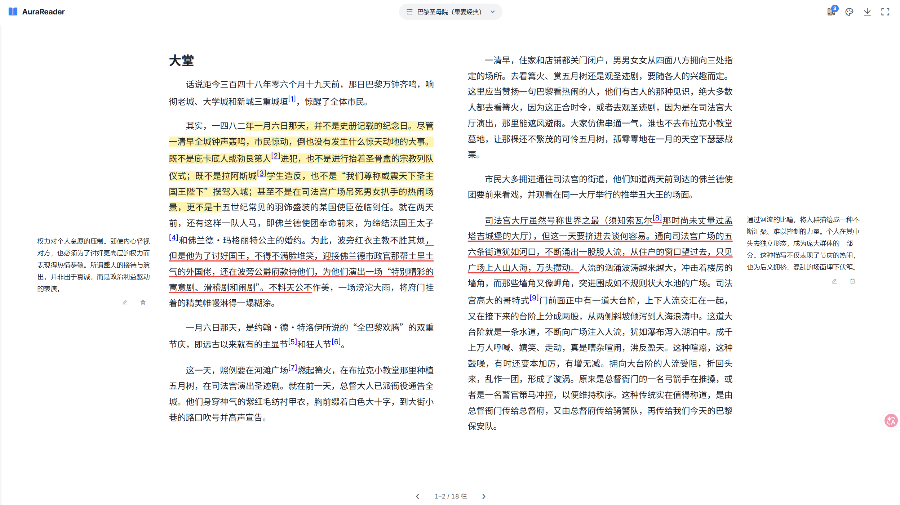
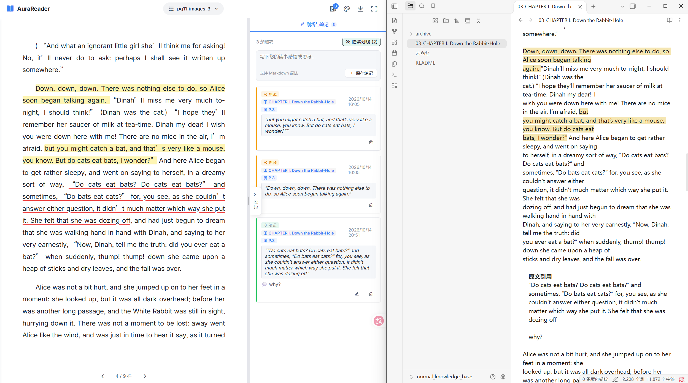

# AuraReader Workstation

AuraReader 是一个面向 PC 的本地 EPUB 阅读与笔记工作台，提供 Windows x64 Electron 桌面候选版，并保留 Node.js 本地服务与浏览器模式。

相比平板，PC 拥有更自由和强大的软硬件生态、更便捷的键盘与鼠标操作，以及更充裕的显示空间。大尺寸显示器能够同时容纳更多阅读内容、功能界面及其他软件，减少屏幕空间对阅读和工作的限制。

AuraReader 正是基于这些优势而开发，致力于提供舒适的阅读排版、简洁高效的功能交互、便捷且沉浸式的高亮与笔记体验，并支持将书籍、高亮和笔记整合导出，让阅读成果能够在其他软件和平台中继续使用。



双页阅读、高亮与沉浸式页边笔记（《巴黎圣母院》示例）。

## Why AuraReader?

**The work of reading goes beyond reading itself.**

你知道的，市面上有很多阅读器。当你想要打开一本电子书——EPUB——开始阅读时，你读了，*You read… and… it’s over.* 这就完了。

当你开始在这本 EPUB 上写笔记时，你会发现，并不是每个阅读器都能在侧边实时展示你所做的笔记，并很好地将它们关联到原文。当你想要导出时，他们“慷慨”地给你提供了各种选择：导出图书、导出笔记、导出高亮。但你究竟需要的是什么呢？居然没有导出一个（图书+笔记+高亮）的方式。这很奇怪。你阅读的产物在导出时不应该被强行分裂。

问题还不止于此。你想把阅读工作的产物（书籍内容+高亮+笔记）带到其他平台和软件中继续使用，或者直接喂给 AI，却发现，导出成一种方便阅读、编辑和迁移的格式，也并没有那么容易。没错，我所说的就是 **Markdown**。

还有，许多阅读器总是在做大而全的功能库。当你使用它们时，有一个功能，明明是你想要的，却因为功能太多，你从来没有发现过它。有一个功能，明明你想快速找到它，却发现自己需要翻找各种各样的设置。你需要一个最简单、最便捷的阅读器。

**So, you need AuraReader. It’s for the work of reading, not just letting your eyes pass over the words.**

## 功能

- **阅读 Goal**：在单页阅读左侧直接写下自己的目标、问题或期待，支持子 Goal、章节相关子 Goal 和完整树导航。笔记原操作区与高亮原浮条中的 `Goal` 按钮，将材料归入当前 Goal；归入或重新选择 Goal 后自动展开摘录。点击摘录回到原文，`×` 只解除关联。点击 Goal 文字即可原位编辑，没有分类步骤或独立编辑面板。左侧空间不足、双页或滚动模式下暂时隐藏，数据仍保留。
- **沉浸式页边笔记**：在正文中选择文字即可添加高亮或笔记。高亮保留在正文中，笔记直接显示在对应原文外侧，不需要展开侧栏。笔记区只显示你的笔记内容，原文引用仍保留在编辑和导出中；点击笔记可以定位原文，也可直接编辑、删除。
- **跟随当前屏幕**：默认只显示与当前可见正文相交的笔记，双页包含左右两页。跨页引用只要仍有一部分原文可见，就保留该笔记；翻页、滚动或调整排版后自动更新。不再新建无原文引用的独立随笔，已有数据仍保留在存储和备份中。
- **两种主要导出方式**：
  - 想保留书籍内容并在 AuraReader 中备份、恢复，选择 **“导出书籍备份”（`.aurabackup`）**。每本书生成一个备份文件，包含书籍正文、目录以及高亮和笔记。
  - 想保存为 Markdown、放入知识库或直接提供给 AI，选择 **“按章节导出”（`.md`）**。菜单原位展开“当前章节／全部章节／选择章节”，前两项直接保存，自选时才展开章节列表，不遮挡阅读界面。高亮保留为 `<mark>原文</mark>`；笔记附准确原文引用，并放在对应段落之后。
  - **单章保存为 `.md`，多章选择位置后新建“书名_章节导出”文件夹**，内含各章 Markdown 和 `00_目录概览.md`，保留原章节编号；同名文件夹自动加序号，不覆盖已有导出。纯卷标题随对应首章保留，同篇正文的多个目录项一并导出。HTML 导出已废弃。
  - 桌面端使用系统文件／目录选择器；网页版多章导出需要浏览器提供文件夹保存能力，不支持时会提示使用桌面版，不自动改为 ZIP。

  下图左侧展示了书籍在 AuraReader 中的单页阅读与页边笔记效果，右侧展示了同一章节导出 Markdown 后在 VS Code 中的预览效果，也可在 Obsidian 等支持 Markdown 的编辑器中使用。若希望保留为可在 AuraReader 中恢复的电子书备份，选择 `.aurabackup`；若只想导出笔记摘要，也可以单独选择 **“笔记摘要”（`.md`）**。页边笔记的筛选不影响全书导出与备份。

  

- **阅读与导航**：导入 EPUB、TXT，使用书库和目录打开书籍、跳转章节；支持单页、双页及连续滚动阅读，笔记直接显示在正文旁。
- **简洁排版**：正文与页边笔记共享阅读背景，没有侧栏分界线、卡片边框或展开操作。双页每栏保持 560px、栏间距 72px；笔记按窗口空间排列在两侧、右侧或底部，不挤压双页行宽。窗口不足以容纳完整双页时，自动暂用单页。
- **字体设置**：默认按书籍语言自动选择字体；内置更纱黑体和 Literata，正文精选字体随应用分发，离线可用。通过“更多字体”搜索本机字体，或导入 TTF、OTF、WOFF2。字体偏好对所有书籍生效。
- **其他阅读设置**：字号、首行缩进、阅读背景、单页／双页版式、界面明暗及全屏。
- **其他导出格式**：需要离线阅读时，可导出带标注的 HTML 电子书。

## 安装与启动

Windows x64 桌面候选版使用 `AuraReader-Setup-1.0.0-x64.exe` 安装，安装后从桌面或开始菜单的 AuraReader 快捷方式启动。应用自带 Electron、Node.js 与 SQLite，日常使用无需另装 Node.js、打开浏览器或运行终端。首次启动点击“创建独立桌面书库”，随后导入 EPUB/TXT。候选安装包和 SHA256 校验文件由下方 `npm run dist:win` 生成在 `release/`，未发布到在线下载服务。

桌面默认数据位置为 `%APPDATA%\AuraReader`，其中 `data/aurareader.sqlite` 保存书籍及笔记，`data/fonts/` 保存导入字体；正常升级和卸载保留数据。当前只支持现用 SQLite 和当前书籍备份，不提供旧数据库自动迁移。安装包目前**未签名**；实际 NSIS 静默安装、版本升级、卸载和重装已经验证，安装向导逐页操作、纯净 Windows 虚拟机以及签名后的系统信任流程尚未验收。具体证据与限制见 [阶段 5 记录](docs/electron-desktop-stage5.md)。

浏览器模式继续提供源码运行方式，已在 Windows 和 Node.js 24.16.0 上验证。此模式要求 **Node.js >= 24.15.0**，使用内置 `node:sqlite`，并建议使用近期版本的 Chrome 或 Edge。本地服务只监听 `127.0.0.1`。

下载项目并解压，或克隆仓库，然后在项目根目录打开终端：

```powershell
npm ci
npm start
```

在浏览器中访问 [http://localhost:8095/](http://localhost:8095/)。使用期间保持终端和本地服务运行；在终端按 `Ctrl+C` 停止服务。

如果默认端口被占用，可以在 PowerShell 中指定其他端口：

```powershell
$env:PORT = '8096'
npm start
```

随后访问 `http://localhost:8096/`。SQLite 书库属于这份项目的 `data/` 目录，同一本地服务的不同浏览器或端口共用该书库；阅读偏好仍按浏览器访问地址保存。升级前的 IndexedDB 数据按原地址隔离，首次迁移应从原来的浏览器、配置文件和访问地址打开。

## 基本使用

1. 点击顶部书库图标，导入 EPUB 或 TXT，再打开书籍。
2. 点击书名旁的目录入口跳转章节，使用底部分页导航阅读。
3. 在正文中选择文字，添加划线或笔记；在页边笔记区查看、编辑及定位原文。
4. 点击顶部界面选项图标调整阅读设置。选择字体后立即应用；“更多字体”可读取本机字体、搜索或导入本地字体文件。
5. 点击顶部全屏按钮前的“导出与备份”图标，选择导出格式、导出书籍备份，或导入恢复备份。

| 快捷键 | 操作 |
| --- | --- |
| `D` | 切换单页／双页 |
| `←` / `→` | 上一页／下一页 |

输入文字或打开对话框时，阅读快捷键会受到互锁保护。

## 数据与备份

- 书籍解析结果、高亮和笔记由本地 Node.js 服务保存在 **`data/aurareader.sqlite`**。书籍和标注分别保存完整 JSON 对象，标注关联书籍；该目录不纳入 Git。应用不提供云同步或 AI 服务。
- 阅读偏好仍保存在浏览器 localStorage；保存失败时只保留尚未确认的操作作为短期恢复缓冲，成功后清理，不维持整书缓存或第二套主数据库。遇到保存冲突时，输入会保留在本机，请保留页面并处理冲突，勿清理站点数据。
- 用户导入的字体由本地服务保存到项目的 `data/fonts/`，该目录不纳入 Git。迁移应用目录时，如需保留这些字体，应一并复制该目录。
- `.aurabackup` **每个文件对应一本书**，保存解析后的正文、目录、Goal 树，以及可选择包含的高亮和笔记。批量选择多本书会分别生成文件。1.1 版包含 Goal 与标注的关联；取消“包含高亮与笔记”时仍备份 Goal 文字和层级，但省略关联。恢复旧 1.0 备份不会清除已有 Goal；不含关联的备份也不会清除目标书已有的关联。
- 书籍备份不包含全局阅读设置、自定义字体文件，也不是原始 EPUB 文件的逐字节副本。建议另行保留原始 EPUB。
- 更换设备或替换项目目录前，请导出书籍备份，或完成 SQLite 一致性备份并妥善保留整个 `data/` 目录。清理浏览器数据不会删除已确认写入 SQLite 的书库，但会删除阅读偏好和尚未写入成功的恢复缓冲。

### 从旧版本迁移

升级前先结束当前笔记编辑，关闭其他 AuraReader 标签页并停止旧服务，保留原项目和 `data/`。启动新版后，在**原浏览器、原配置文件、原访问地址**打开阅读器。首次启动会读取旧 `AuraReaderDB`，只使用只读事务，不会删除、清空或继续双写 IndexedDB。

迁移首先将原始数据库、相关缓存和待写操作分别归档到 `data/migration-snapshots/<来源哈希>/<快照哈希>/`，再合成有效数据：数据库记录优先，明确的待写保存／删除覆盖旧记录；普通旧缓存不能覆盖数据库。历史独立随笔、示例书关联、未知 JSON 字段、章节 HTML 和选区偏移均保留，不重新解析 EPUB。校验完整对象、内容哈希、关联和 SQLite 完整性后才切换；成功后只移除已归档的旧缓存及待写操作，旧 IndexedDB 原样保留。

若发现同 ID 不同内容、无法判断的仅缓存标注、损坏记录或无主标注，会停止该来源的切换，报告冲突并保存 `conflicts.json`。不得通过清空旧数据或删除迁移标识绕过冲突。迁移上传后中断可重新打开继续；同一份快照重复提交不会重复入库。不同浏览器的旧书库需要分别从各自原地址迁移，冲突不能静默合并。单次快照上传上限为 256MB，超过时会停止，不截断数据。

### 数据库校验与备份

```powershell
node src/server/storageMaintenance.js verify
node src/server/storageMaintenance.js backup
```

`backup` 使用 SQLite 在线备份接口，在 `data/backups/` 生成可独立打开并通过完整性校验的 `.sqlite` 文件，包含备份时已提交的数据。不要只复制正在运行的主文件而遗漏 WAL。

恢复备份前先停止服务，保留现有 `data/` 整体副本，在隔离目录验证备份后再替换数据库；不要覆盖运行中的库或遗留旧的 WAL/SHM 文件。`storage-installed.json` 用于识别已建立的书库；若数据库丢失／为空，服务会停止，避免悄悄新建空库。迁移原始快照用于重建迁移时的基线，之后的新修改应从 SQLite 备份或书籍备份恢复。不会自动回到旧 IndexedDB。

## 开发与测试

Electron Windows 桌面迁移已进入阶段 6 的本地验证，保留 Windows x64 NSIS 候选安装包，暂不发布。运行 `npm run desktop` 也可从源码创建独立桌面书库，通过 Windows 原生对话框导入 EPUB/TXT、阅读并保存高亮和笔记；可读取系统字体、导入 TTF/OTF/WOFF2，以及保存 Markdown、带标注 HTML、章节 ZIP 和每书 `.aurabackup`，并恢复当前书籍备份。文件取消与保存失败会明确反馈，多书备份显示实际保存数量。桌面资源与 JSZip 随应用提供，离线运行不使用 localhost 服务。

首次创建书库需明确点击；桌面 SQLite 和导入字体位于 `%APPDATA%\AuraReader\data`，不在安装目录内。按当前范围只保证现用 SQLite 的读写、版本/幂等、备份与恢复，不提供旧数据库或 IndexedDB 的桌面迁移；未知或缺失数据库仍阻断启动，不静默清库。浏览器模式继续独立运行，上文旧版迁移说明仅适用于现有浏览器模式。阶段 6 增加实际 SQLite 容量、只读和锁竞争故障、Renderer/主进程终止恢复、大书与持续读写、打包程序及安装生命周期验证，并修复容量错误掩盖与页面关闭漏保存。发布验收仍有未验证项；最新证据与限制见 [阶段 6 记录](docs/electron-desktop-stage6.md)，安装设计见 [阶段 5](docs/electron-desktop-stage5.md)，文件功能见 [阶段 4](docs/electron-desktop-stage4.md)，历史记录见 [阶段 3](docs/electron-desktop-stage3.md)、[审计](docs/electron-desktop-audit.md)和[外壳记录](docs/electron-desktop-stage2.md)。

源码位于 `src/client/` 和 `src/server/`；前端采用渐进式 TypeScript 迁移，`npm start` 会先检查类型并构建到 `dist/client/`，再启动服务。依赖安装后，可以运行：

```powershell
npm test                 # 语法、单元和回归检查
npm run build            # 严格类型检查并生成浏览器使用的 JavaScript
npm run typecheck        # 只检查类型
npm run test:unit        # 单元测试
npm run test:regression  # 回归检查
npm run test:syntax      # JavaScript 语法检查
npm run desktop          # Windows x64 桌面预览，书库通过 IPC 访问，不启动 HTTP 服务
npm run test:desktop     # 真实 Electron 窗口、SQLite 运行时与安全检查
npm run test:stability   # 独立 profile 的故障、异常终止恢复、大书及默认 300 秒持续读写；可附 -- 600
npm run test:packaged:stability # 复验已有 win-unpacked 的真实 exe；先运行 dist:win
npm run test:desktop:native # 交互验收真实 Windows 文件对话框，按终端提示选项目测试素材
npm run dist:win          # 构建 Windows x64 NSIS 候选包，并校验资源、许可和安全 fuses
npm run verify:package    # 核对已有 win-unpacked，并生成安装包 SHA256 与检查报告
npm run test:install      # 构建候选/升级测试包，真实安装、升级、卸载和重装（需无现有 AuraReader 安装）
```

修改源码后重新运行 `npm run build` 并刷新浏览器；直接运行 `node src/server/server.js` 前也需先构建。迁移边界及运行方式见 [TypeScript 迁移说明](docs/typescript-migration.md)。

测试素材 `tests/fixtures/test.epub` 是 Project Gutenberg 的英文版《爱丽丝梦游仙境》，保留书内原始声明与许可。素材来源见 [测试素材说明](tests/fixtures/README.md)。嵌套目录另由自写测试样例验证。

## 当前限制与许可

- 当前支持 EPUB 和 TXT。虽然文件选择器包含 PDF 扩展名，但尚未实现 PDF 正文解析，不应将其视为支持的阅读格式。
- “原书字体”选项暂未启用；当前 EPUB 解析流程不会完整保留出版方的样式和字体规则，复杂排版与原书可能存在差异。
- 本机字体读取已在 Windows 本地服务下验证；其他环境取决于浏览器能力和授权，无法读取时仍可导入字体文件。
- 浏览器模式的界面图标、界面字体和 JSZip 仍引用外部 CDN，不能保证完整离线启动。桌面模式使用本地图标、内置正文精选字体与 JSZip，已验证断网启动、EPUB 导入及 ZIP 导出。
- 页边笔记排版主要在桌面窗口验证；手机等小屏设备和复杂 EPUB 尚需进一步测试。
- 重新加载页面时，当前不会自动恢复上次打开的书籍和阅读位置；书库中的书籍和笔记仍可重新打开。
- 项目代码采用 [Apache License 2.0](LICENSE)，版权声明为 Copyright © 2026 yhdmjywx。内置字体遵循各自许可证，来源与原文见 [字体资源说明](src/client/assets/fonts/README.md) 和其 `licenses/` 目录；第三方依赖遵循其各自许可证。测试书籍的原始声明与许可保留在 EPUB 内，不纳入项目代码的 Apache-2.0 许可范围。
