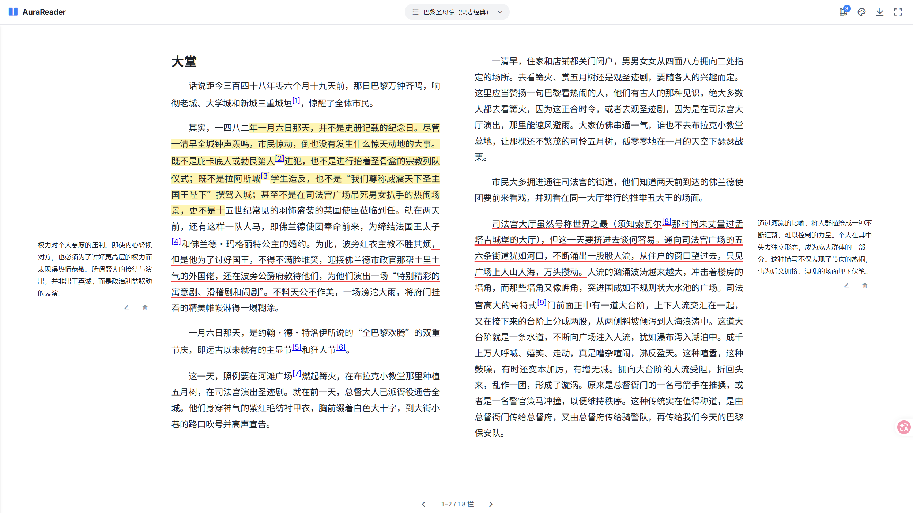
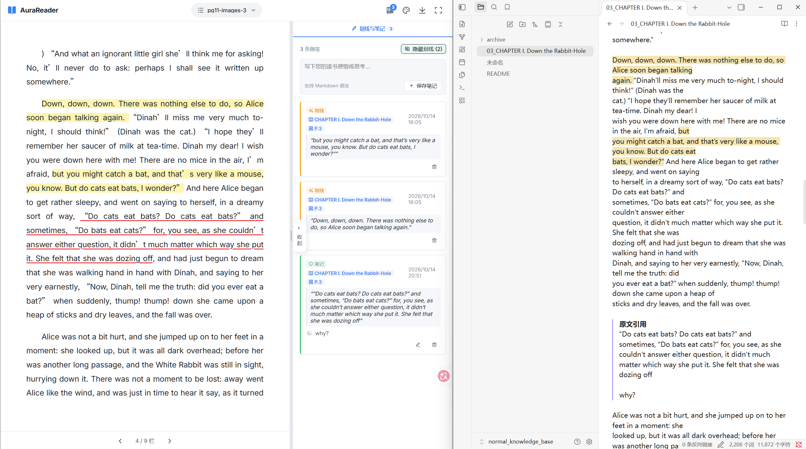

# AuraReader Workstation

AuraReader 是一个本地阅读与笔记工作台：通过 Node.js 在本机启动服务，在浏览器中阅读 EPUB、记录高亮和笔记，并按书籍导出备份。



双页阅读、高亮与笔记侧栏（《爱丽丝梦游仙境》示例）。

## Why AuraReader?

**The work of reading goes beyond reading itself.**

你知道的，市面上有很多阅读器。当你想要打开一本电子书——EPUB——开始阅读时，你读了，*You read… and… it’s over.* 这就完了。

当你开始在这本 EPUB 上写笔记时，你会发现，并不是每个阅读器都能在侧边实时展示你所做的笔记，并很好地将它们关联到原文。当你想要导出时，他们慷慨地给你提供了各种选择：导出图书、导出笔记、导出高亮。但你究竟需要的是什么呢？居然没有导出一个（图书+笔记+高亮）的方式。这很奇怪。你阅读的产物在导出时不应该被强行分裂。

问题还不止于此。你想把阅读工作的产物（书籍内容+高亮+笔记）带到其他平台和软件中继续使用，或者直接喂给 AI，却发现，导出成一种方便阅读、编辑和迁移的格式，也并没有那么容易。没错，我所说的就是 **Markdown**。

还有，许多阅读器总是在做大而全的功能库。当你使用它们时，有一个功能，明明是你想要的，却因为功能太多，你从来没有发现过它。有一个功能，明明你想快速找到它，却发现自己需要翻找各种各样的设置。你需要一个最简单、最便捷的阅读器。

**So, you need AuraReader. It’s for the work of reading, not just letting your eyes pass over the words.**

## 功能

- **侧边高亮与笔记**：在正文中选择文字即可添加高亮或笔记。高亮保留在正文中，笔记在侧边栏集中查看，并带有原文引用，方便回看上下文、编辑想法和定位原文。
- **两种主要导出方式**：
  - 想保留书籍内容并在 AuraReader 中备份、恢复，选择 **“导出书籍备份”（`.aurabackup`）**。每本书生成一个备份文件，包含书籍正文、目录以及高亮和笔记。
  - 想保存为 Markdown、放入知识库或直接提供给 AI，选择 **“分章节正文与笔记”（`.zip`）**。压缩包按章节保存 Markdown：高亮直接标记在正文中，笔记附原文引用与笔记内容，并放在对应原文段落之后。

  下图左侧展示了导出 `.aurabackup` 并在 AuraReader 中恢复后的效果，右侧展示了导出 Markdown 后在 Obsidian 等支持 Markdown 的编辑器中的效果。若只想导出笔记摘要，也可以单独选择 **“笔记摘要”（`.md`）**。

  

- **阅读与导航**：导入 EPUB、TXT，使用书库和目录打开书籍、跳转章节；支持单页、双页阅读，以及笔记侧栏展开和收起。
- **简洁排版**：分页正文移除外围圆角边框和阴影。当前主要验证约 1613 × 928px 的窗口；笔记收起时双页每栏最多 560px、栏间距 72px，展开时按可用宽度收窄。
- **字体设置**：默认按书籍语言自动选择字体；内置更纱黑体、思源宋体、霞鹜文楷、Literata、Source Serif 4，正文精选字体随应用分发。通过“更多字体”搜索本机字体，或导入 TTF、OTF、WOFF2。字体偏好对所有书籍生效。
- **其他阅读设置**：字号、首行缩进、阅读背景、单页／双页版式、界面明暗及全屏。
- **其他导出格式**：需要离线阅读时，可导出带标注的 HTML 电子书。

## 安装与启动

当前提供源码运行方式，已在 Windows 和 Node.js 24.16.0 上验证。建议使用 Node.js 24（至少 24.15.0），并使用近期版本的 Chrome 或 Edge。

下载项目并解压，或克隆仓库，然后在项目根目录打开终端：

```powershell
npm ci
npm start
```

在浏览器中访问 [http://localhost:8095/](http://localhost:8095/)。使用期间保持终端和本地服务运行；在终端按 `Ctrl+C` 停止服务。

如果默认端口被占用，可以在 PowerShell 中指定其他端口：

```powershell
$env:PORT = '8096'
npm start
```

随后访问 `http://localhost:8096/`。浏览器存储按访问地址区分，更换端口或改用其他地址时，原地址的书库不会自动出现。

## 基本使用

1. 点击顶部书库图标，导入 EPUB 或 TXT，再打开书籍。
2. 点击书名旁的目录入口跳转章节，使用底部分页导航阅读。
3. 在正文中选择文字，添加划线或笔记；在笔记侧栏查看、编辑及定位原文。
4. 点击顶部界面选项图标调整阅读设置。选择字体后立即应用；“更多字体”可读取本机字体、搜索或导入本地字体文件。
5. 点击顶部全屏按钮前的“导出与备份”图标，选择导出格式、导出书籍备份，或导入恢复备份。

| 快捷键 | 操作 |
| --- | --- |
| `D` | 切换单页／双页 |
| `B` | 展开／收起笔记侧栏 |
| `←` / `→` | 上一页／下一页 |
| 双击分割条 | 展开／收起笔记侧栏 |

输入文字或打开对话框时，阅读快捷键会受到互锁保护。

## 数据与备份

- 书籍解析结果、高亮和笔记保存在当前浏览器的 IndexedDB 中；阅读设置和字体选择等偏好保存在浏览器本地存储中。应用不提供云同步或 AI 服务。
- 用户导入的字体由本地服务保存到项目的 `data/fonts/`，该目录不纳入 Git。迁移应用目录时，如需保留这些字体，应一并复制该目录。
- `.aurabackup` **每个文件对应一本书**，保存解析后的正文、目录，以及可选择包含的高亮和笔记。批量选择多本书会分别生成文件。
- 书籍备份不包含全局阅读设置、自定义字体文件，也不是原始 EPUB 文件的逐字节副本。建议另行保留原始 EPUB。
- 更换设备、浏览器或访问地址之前，先导出书籍备份；在新的环境中使用“导入恢复备份”。浏览器清理站点数据可能删除本地书库和笔记。

## 开发与测试

源码位于 `src/client/` 和 `src/server/`；无需构建即可启动。依赖安装后，可以运行：

```powershell
npm test                 # 语法、单元和回归检查
npm run test:unit        # 单元测试
npm run test:regression  # 回归检查
npm run test:syntax      # JavaScript 语法检查
```

测试素材 `tests/fixtures/test.epub` 是 Project Gutenberg 的英文版《爱丽丝梦游仙境》，保留书内原始声明与许可。素材来源见 [测试素材说明](tests/fixtures/README.md)。嵌套目录另由自写测试样例验证。

## 当前限制与许可

- 当前支持 EPUB 和 TXT。虽然文件选择器包含 PDF 扩展名，但尚未实现 PDF 正文解析，不应将其视为支持的阅读格式。
- “原书字体”选项暂未启用；当前 EPUB 解析流程不会完整保留出版方的样式和字体规则，复杂排版与原书可能存在差异。
- 本机字体读取已在 Windows 本地服务下验证；其他环境取决于浏览器能力和授权，无法读取时仍可导入字体文件。
- 内置正文精选字体可由本地服务提供，但界面图标、界面字体和浏览器端 JSZip 仍引用外部 CDN。首次加载及部分功能依赖这些资源可用，当前不能保证完整离线启动。
- 排版改动主要针对当前默认窗口验证，其他窗口尺寸和复杂 EPUB 尚需进一步测试。
- 重新加载页面时，当前不会自动恢复上次打开的书籍和阅读位置；书库中的书籍和笔记仍可重新打开。
- 项目代码采用 [Apache License 2.0](LICENSE)，版权声明为 Copyright © 2026 yhdmjywx。内置字体遵循各自许可证，来源与原文见 [字体资源说明](src/client/assets/fonts/README.md) 和其 `licenses/` 目录；第三方依赖遵循其各自许可证。测试书籍的原始声明与许可保留在 EPUB 内，不纳入项目代码的 Apache-2.0 许可范围。
