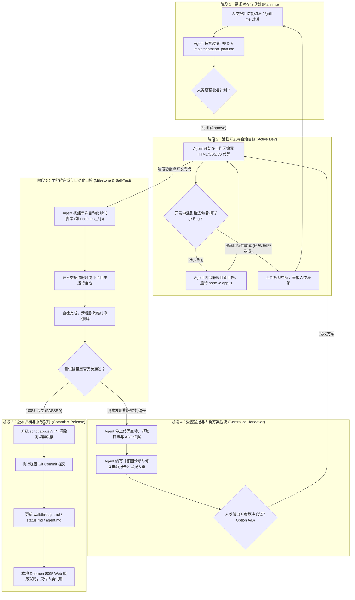

# AuraReader Workstation - 完整协同工作流落地架构 (Workflow Architecture)

---

## 1. 完整工作流全景图 (End-to-End Workflow Diagram)

---

## 2. 五大阶段的具体运作机制与规范 (Phase Breakdown)

### 阶段 1：需求探讨与计划制定 (Planning & Alignment)
- **触发条件**：人类提出新功能诉求（如“首行缩进多档调节”、“分章节导出且高亮不重复”）。
- **运作机制**：
  1. 可结合 `/grill-me` 互动式提问，通过 1~3 个针对性选项快速消除设计歧义。
  2. Agent 编写/更新 `implementation_plan.md`，明确边界限制。
  3. 人类确认后启动开发。

### 阶段 2：活性开发与细小 Bug 自治处理 (Active Dev & Minor Fixes)
- **触发条件**：进入代码编写过程。
- **运作机制**：
  1. Agent 在 `e:\dp\reader_workstation\` 中修改代码。
  2. **细小 Bug 自治**：若遭遇 `node -c app.js` 语法报错、变量拼写错漏、DOM 选择器微调，**Agent 自行修掉，不打扰人类**，维持最大编码吞吐量。
  3. **阻断停工保护**：若遇到端口强占、权限拒绝、依赖崩溃等阻断故障，**触发中断呈报**，向人类递交《阻断说明》，等待人工干预。

### 阶段 3：里程碑完成与自动化自检 (Milestone & Self-Test)
- **触发条件**：某一阶段里程碑（如 IndexedDB 离线书库）开发完毕。
- **运作机制**：
  1. Agent 在人类提供的测试环境下，自动构建无污染的自检脚本（如 `deep_export_verification.js`）。
  2. 运行自动化检验套件，自检 0 语法报错与排版逻辑正确性。
  3. 检验完毕后，测试临时脚本自动从磁盘删除，保证 Git 工作区 100% 干净。

### 阶段 4：受控呈报与人类方案裁决 (Controlled Handover & Decision)
- **触发条件**：阶段测试自检发现非预期问题（如文本二次重复）。
- **运作机制**：
  1. Agent 严格触发受控修复契约，**绝不擅自暗箱变动主代码逻辑**。
  2. 提交《诊断与修复方案选项》呈报人类（例如：方案 A 行内嵌入 `==高亮==` vs 方案 B 章节末尾脚注区）。
  3. 人类选定方案做出授权后，Agent 精准落实修改代码。

### 阶段 5：版本归档与服务就绪 (Commit & Release)
- **触发条件**：测试 100% 成功通过。
- **运作机制**：
  1. 升号缓存参数（如 `app.js?v=9`），强制浏览器清除旧代码缓存。
  2. 提交规范 Git Commit（如 `feat:` / `fix:` / `refactor:`）。
  3. 同步刷新 `walkthrough.md`、`status.md` 及 `agent.md`。
  4. Web Daemon 服务在 `http://localhost:8095` 实时就绪供人类验证试用。

---

## 3. 实战演练示例 (Real-World Execution Trace)

在本项目的实际演进中，本工作流已完美成功运转：

1. **案例 1：高亮文本在导出文件中重复**
   - *Phase 3*：Agent 运行测试发现了 `原文：“...”` 的冗余重复现象。
   - *Phase 4*：Agent 停止主代码擅自修改，整理向人类汇报，提供“行内 `==高亮==` 嵌入 + 无随笔 0 追加”的解决方案。
   - *Phase 4*：人类回复确认该方案。
   - *Phase 5*：Agent 精准落盘代码，通过二轮验证，提交 Git `ef75f2b`，更新 `walkthrough.md` 并完成交付。

2. **案例 2：划线随笔 Modal 弹窗无响应**
   - *Phase 2*：Agent 在开发自检中发现点击“保存划线笔记”无响应，排查发现监听器误放在 `parseTxtContent` 局部作用域内。
   - *Phase 2*：属于开发活性期的 Bug，Agent 自行将其提升至 `initUIControls()` 全局作用域，自修完成并提交 Git `f204985`。

---

## 4. ⚙️ Antigravity Skills 动态调用与调度指南

Google Antigravity 拥有强大的技能扩展生态（Skills），Agent 能够根据当前阶段任务自动匹配并触发对应 Skills，赋能全流程安全与自动化：

### 4.1 数据安全与防误删保障 (`accidental-data-loss-prevention`)
- **触发场景**：涉及代码覆盖、数据库重置或文件批量删除操作前。
- **运行规则**：Agent 自动评估破坏性风险，若涉及危险操作（如清除用户 IndexedDB 或覆盖未备份代码），触发二次确认，杜绝生产数据意外丢失。

### 4.2 环境与依赖自动化校验 (`managing-python-dependencies` / `uv`)
- **触发场景**：测试环境初始化或安装依赖时。
- **运行规则**：Agent 自动感知当前测试虚拟环境（`uv` / `node`），避免全局污染与依赖冲突，确保测试套件在一个安全沙箱中自主运行。

### 4.3 自自我诊断与技能修复 (`antigravity-guide` / `skill-repair`)
- **触发场景**：当 Agent 在执行特定指令发现工具损坏或需要调取 Antigravity 标准参考时。
- **运行规则**：Agent 自动调用 `skill-repair` 修复坏损的技能配置，或参考 `antigravity-guide` 引导人类使用 `/grill-me` 互动对齐需求、使用 `/goal` 进行长周期任务追踪。

---

## 5. 💡 Antigravity 原生命令模式与工作流的共生促进架构 (Synergistic Command Modes Integration)

Antigravity 原生的斜杠命令与操作模式（Slash Commands）与本 5 阶段工作流架构并非冲突关系，而是**完美共生、深度互相促进**的关系。

- **工作流架构（Workflow Architecture）**：提供了**软件工程的完整生命周期与安全边界**（解决“在什么阶段做些什么”）。
- **命令模式（Slash Commands & Modes）**：提供了**人机在特定环节下的即时交互增强工具**（解决“如何在这个阶段高效交互”）。

### 5.1 映射与共生矩阵 (Synergy Mapping Matrix)

| 原生命令 / 模式 | 最优嵌入工作流阶段 | 深度促进与协同机制 |
| --- | --- | --- |
| **`/grill-me` (专访对齐模式)** | **阶段 1：需求对齐与规划** | 在撰写 PRD 或 `implementation_plan.md` 前启动专访，通过 1~3 个针对性选项消除歧义（例如本次关于高亮排版与 PRD 选型），确保规划 100% 准确。 |
| **`/btw` (顺带旁白模式)** | **阶段 2：活性开发与自治** | 在 Agent 处于阶段 2 连续编写代码或自修细小 Bug 时，人类通过 `/btw` 插入不打断主开发流程的补充想法或澄清，实现无阻塞旁白交流。 |
| **`/goal` (无人值守目标追踪)** | **阶段 3 与 阶段 5** | 当需要 Agent 自主跑完大规模测试套件、重构多模块或长周期监控时启动，赋予 Agent 持续自我驱动力，直达目标完成。 |
| **`/learn` (知识偏好沉淀)** | **阶段 4 与 阶段 5** | 当人类在阶段 4 选定某项排版或代码风格裁决后，使用 `/learn` 将其持久化记入 Agent 行为规范，后续开发全自动遵循。 |
| **`/schedule` (定时巡检提醒)** | **阶段 3 与 阶段 5** | 设定一针或定时 Cron 任务，定期巡检本地 Daemon 服务（`http://localhost:8095`）或日志状态，确保长效运维。 |
| **`/browser` (浏览器增强调试)** | **阶段 3：自动化自检** | 在阶段 3 进行 UI 或视觉验证时，调用 Web 浏览器调试工具直接读取 DOM 与渲染画面，提升自检精准度。 |
