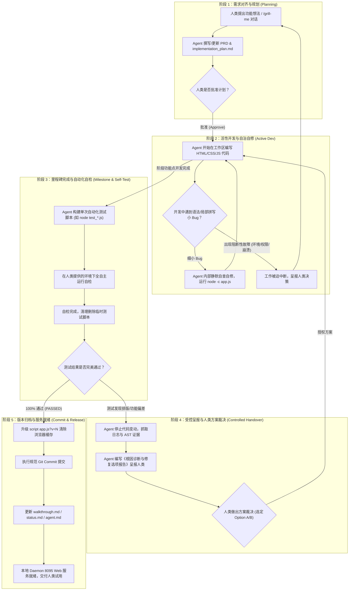

# AuraReader Workstation - 完整协同工作流落地架构 (Workflow Architecture)

---

## 1. 完整工作流全景图 (End-to-End Workflow Diagram)

---

## 2. 五大阶段的具体运作机制与规范 (Phase Breakdown)

### 阶段 1：需求探讨与计划制定 (Planning & Alignment)
- **触发条件**：人类提出新功能诉求（如“首行缩进多档调节”、“分章节导出且高亮不重复”）。
- **运作机制**：
  1. 可结合 `/grill-me` 互动式提问，通过 1~3 个针对性选项快速消除设计歧义。
  2. Agent 编写/更新 `implementation_plan.md`，明确边界限制。
  3. 人类确认后启动开发。

### 阶段 2：活性开发与细小 Bug 自治处理 (Active Dev & Minor Fixes)
- **触发条件**：进入代码编写过程。
- **运作机制**：
  1. Agent 在 `e:\dp\reader_workstation\` 中修改代码。
  2. **细小 Bug 自治**：若遭遇 `node -c app.js` 语法报错、变量拼写错漏、DOM 选择器微调，**Agent 自行修掉，不打扰人类**，维持最大编码吞吐量。
  3. **阻断停工保护**：若遇到端口强占、权限拒绝、依赖崩溃等阻断故障，**触发中断呈报**，向人类递交《阻断说明》，等待人工干预。

### 阶段 3：里程碑完成与自动化自检 (Milestone & Self-Test)
- **触发条件**：某一阶段里程碑（如 IndexedDB 离线书库）开发完毕。
- **运作机制**：
  1. Agent 在人类提供的测试环境下，自动构建无污染的自检脚本（如 `deep_export_verification.js`）。
  2. 运行自动化检验套件，自检 0 语法报错与排版逻辑正确性。
  3. 检验完毕后，测试临时脚本自动从磁盘删除，保证 Git 工作区 100% 干净。

### 阶段 4：受控呈报与人类方案裁决 (Controlled Handover & Decision)
- **触发条件**：阶段测试自检发现非预期问题（如文本二次重复）。
- **运作机制**：
  1. Agent 严格触发受控修复契约，**绝不擅自暗箱变动主代码逻辑**。
  2. 提交《诊断与修复方案选项》呈报人类（例如：方案 A 行内嵌入 `==高亮==` vs 方案 B 章节末尾脚注区）。
  3. 人类选定方案做出授权后，Agent 精准落实修改代码。

### 阶段 5：版本归档与服务就绪 (Commit & Release)
- **触发条件**：测试 100% 成功通过。
- **运作机制**：
  1. 升号缓存参数（如 `app.js?v=9`），强制浏览器清除旧代码缓存。
  2. 提交规范 Git Commit（如 `feat:` / `fix:` / `refactor:`）。
  3. 同步刷新 `walkthrough.md`、`status.md` 及 `agent.md`。
  4. Web Daemon 服务在 `http://localhost:8095` 实时就绪供人类验证试用。

---

## 3. 实战演练示例 (Real-World Execution Trace)

在本项目的实际演进中，本工作流已完美成功运转：

1. **案例 1：高亮文本在导出文件中重复**
   - *Phase 3*：Agent 运行测试发现了 `原文：“...”` 的冗余重复现象。
   - *Phase 4*：Agent 停止主代码擅自修改，整理向人类汇报，提供“行内 `==高亮==` 嵌入 + 无随笔 0 追加”的解决方案。
   - *Phase 4*：人类回复确认该方案。
   - *Phase 5*：Agent 精准落盘代码，通过二轮验证，提交 Git `ef75f2b`，更新 `walkthrough.md` 并完成交付。

2. **案例 2：划线随笔 Modal 弹窗无响应**
   - *Phase 2*：Agent 在开发自检中发现点击“保存划线笔记”无响应，排查发现监听器误放在 `parseTxtContent` 局部作用域内。
   - *Phase 2*：属于开发活性期的 Bug，Agent 自行将其提升至 `initUIControls()` 全局作用域，自修完成并提交 Git `f204985`。
